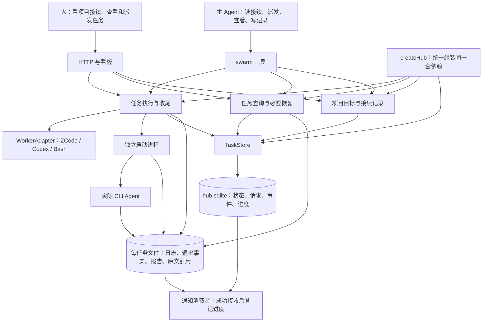
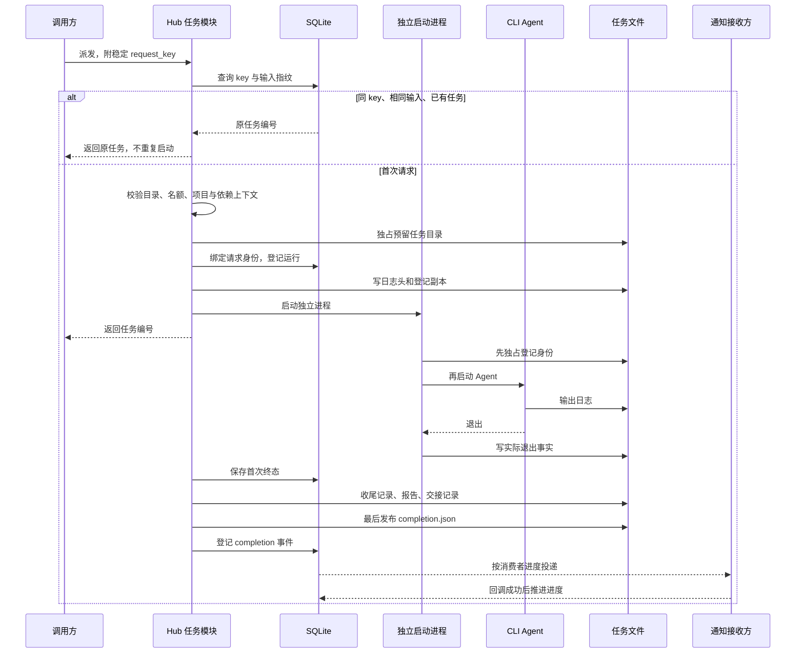

# Agent Hub：任务执行与工作接续

核对日期：2026-10-18。本文描述当前代码；历史设计见 [agent-hub 文档](./agent-hub/README.md)，其中的规划不代表已经实现。

Agent Hub 把任务交给本地 Agent，记录执行事实，让人和主 Agent 在离开后能够接着工作。编码由 ZCode、Codex 或 Bash 子进程执行。**进程结束、Agent 自述成功、需求验收通过，是三件事。平台记录前两件，不替人或上游 Agent 作最后判断。**

## 一套实例，共用一本登记簿

`createHub({ runsDir, getAdapter, env, now })` 是集中组装的位置。它创建或接收同一个 `TaskStore`，再把它交给任务执行、查询和项目接续模块。HTTP、工具、超时巡查、通知也使用这套实例。测试或嵌入者可以传入不同运行目录，让两套 Hub 互不混用资料。

默认实例使用启动工作目录下的 `.swarm-runs`。导入模块、创建 Hub 不会立即创建目录、打开数据库或启动监听；实际读写或启动服务时才获取资源。前端文件从安装位置寻找，不要求调用方把工作目录切到 Agent Hub 源码目录。

HTTP 和工具入口负责接收输入。任务执行模块隐藏派发、停止和收尾的顺序；查询模块整理事实并修复遗漏；项目模块保留目标与接续记录。数据库由具体的 `TaskStore` 保管，没有额外引入通用数据库插件框架。

## 可替换的位置与集中负责的事情

seam 可以理解为“换一种做法，调用方仍按原约定使用”的位置。当前最明确的是 `WorkerAdapter`：三种 CLI 的命令、起跑条件、输出翻译、原文定位与解析各有不同。

| 模块或约定 | 调用方交代什么 | 内部负责什么 |
| --- | --- | --- |
| `createHub` | 运行目录、可选 adapter 和环境 | 把同一套依赖交给各模块 |
| `WorkerAdapter` | 任务文本、工作目录、执行选项 | 不同 CLI 的命令、条件和输出格式 |
| `hub.engine` | 派发、停止或提供退出事实 | 占名额、进程身份、首次终态保留、收尾 |
| `hub.queries` | 任务编号及查询选项 | 恢复、原文、模型信息、详情和对话 |
| `hub.projects` | 项目目标、接续说明和已读位置 | 历史保留、来源检查、变化游标 |
| `TaskStore` | 读取或更新任务、登记请求和事件 | SQLite 状态、兼容文件和并发保护 |
| `onCompletion` | 接收任务及完整报告的回调 | 宿主自行连接真正的通知接收方 |
| `startServer → close` | 监听配置及可选 Hub | HTTP、Vite、巡查、通知和连接释放 |

不同 Agent 的原文先转成统一消息记录，再派生最后回复、对话展示和模型信息。解析缓存随文件身份、大小和修改时间失效。ZCode 能发现本地原文；Codex 有格式解析能力，不代表已经具备相同的自动定位能力。

## 状态在数据库，过程资料在文件

`.swarm-runs/hub.sqlite` 保存任务登记、派发请求身份、任务事件、通知消费者进度、项目、接续记录及项目已读位置。SQLite 使用 WAL 与等待锁的超时设置。相关数据库写入可以一起提交。

已有任务目录中的合法 `meta.json` 会在查询时导入；一旦任务已登记进数据库，以数据库状态为准。`meta.json` 继续作为可读兼容副本，**直接编辑它不再是更新已登记任务的方法**。删除单个任务目录也不等于删除数据库中的任务。

| 每任务文件 | 用途 |
| --- | --- |
| `meta.json` | 任务登记的可读兼容副本 |
| `process.pid` | 启动身份；必要时写 `0` 阻止迟到启动 |
| `process-exit.json` | 独立启动进程保存的实际退出事实 |
| `raw.log` | CLI 输出和错误 |
| `resolution.json` | 停止原因、最终文字、原文和续跑引用 |
| `report.md` | 供人阅读的机械收尾报告 |
| `handoff.json` | Agent 交接自述的解析结果及来源 |
| `completion.json` | 收尾资料已准备好，可以通知 |

**数据库、文件写入与启动操作系统进程不是一个事务。** 数据库不能撤回已经启动的进程，也不能替代身份文件。平台仍靠顺序、跨进程派发锁、原子文件写入和恢复协议，处理任意两步之间的中断。备份或迁移应保留整个运行目录，而非只拷贝 JSON。

## 派发、重试与收尾的顺序

`request_key` 是调用方给同一次请求的稳定名字。网络中断后，使用相同 key 和相同输入重试，会找到原任务；同一个 key 换内容会冲突。故意再次执行应使用新 key。请求身份属于当前 Hub 的数据库，不跨不同运行目录共享。

有一种中断需要明确处理：key 已预留，但尚无可读取的任务登记。平台返回需要恢复的冲突及原任务编号，**不会猜测“没启动”并自动再启动一次**。应检查和恢复原编号，再重读这个 key 的原任务；确认要另起一次工作时，由调用方明确发起新请求。

任务结束后，平台仍可能需要恢复遗漏的报告和发布标记。父平台关闭时，已经独立启动的 CLI 继续运行；主动取消或超时才通过统一终止入口结束进程组。恢复时优先读取实际身份和退出文件；没有退出证据就保留未知，不编造退出码。

## 给下一个 Agent 的交接

`handoff: true` 为 ZCode 或 Codex 追加一个明确输出约定。Agent 在最终消息的 `## Agent Hub Handoff` 段落写 JSON，包括 `schemaVersion`、自报 `status`、`summary`，以及可选的 `verification`、`nextSteps`、`artifacts` 字符串数组。

平台只机械检查格式，保存来源与原文指针。交接记录区分 `reported / missing / invalid / interrupted`。**`selfReport.status = success` 表示 Agent 这样说过，不表示平台验证过。** 缺少或无效交接不会被补写成成功。

`dependsOn` 是已经结束的上游任务编号，要求与下游同属一个项目，或都未关联项目。它不是后台等待队列：仍在运行的上游会使本次请求被拒绝。平台把上游机械状态、交接自述或明确缺失说明放入新任务上下文。项目目标和最新接续记录也可加入；有总长度限制，截断会注明来源。

Bash 的 prompt 就是脚本，不能加入自然语言。关联项目可用于归类和默认目录，但 Bash 不注入项目文字；要求 handoff 或依赖文字注入会被拒绝。续跑句柄是另一回事：`resumeSessionId` 用于启动新一次执行，不承诺能给正在运行的本地会话安全递话。

## 项目是轻量笔记本

项目保留稳定的目标和可选默认工作目录。接续说明是追加记录，可以由人或主 Agent 写；不会替换项目目标，也不会删除旧说明。来源任务必须存在且属于该项目。笔记可独立使用 `request_key`，重复提交取回原记录，换内容则冲突。

建议说明回答三件事：已确认什么、什么仍待验证、下一步从哪里继续。Hub 不调用 LLM 自动生成摘要，不计算主观完成百分比，不自动批准成果或推进下一阶段。`parentTaskId` 记录同项目任务关系，没有自动递归规划器。

项目总览展示目标、最新和历史接续、相关任务，以及上次确认以来的变化。读取不会自动标记已读；调用者明确提交读到的 `through` 序号，且不能跳过未来事件。任务变化通过稳定签名登记序号，重复读取不制造新变化。看板保留全部任务入口，未关联项目的旧任务仍然可查。

## 通知与实时日志的恢复

通知必须由宿主接入 `onCompletion`，或在插件配置中提供 `activeAgentGetter`。默认启动看板不代表能自动向当前聊天发送消息。

- 未设置 `consumerId`：只观察本次启动后的新完成任务，历史终态作为基线。
- 设置稳定 `consumerId`：读取 SQLite 事件，成功回调后才保存处理位置。重启可继续，失败会保留待投递状态并重试。
- 这是 **至少一次** 投递：接收成功但还没登记进度就退出时，可能重发。接收方应按任务编号去重。多个独立通知目的地需要不同消费者身份，不应共享一个处理位置。

文件监听负责及时唤醒，定时检查负责补漏。通知只在完整收尾产物可读后发送。

实时日志用 SSE。浏览器断线后自动重连并携带 `Last-Event-ID`；服务端按文件身份和读取位置续传。日志缩短、替换或已检测到重写时，发送 reset，让浏览器清掉旧显示再继续。读取分块并保留跨块 UTF-8 字节；界面只保留最近约 1MiB 文本。它是实时查看通道，完整日志仍在文件中。

## 开发与查代码

| 目的 | 入口 |
| --- | --- |
| 统一组装 | `src/hub.ts` |
| 项目和接续 | `src/projects.ts`、`src/web/components/ProjectOverview.tsx` |
| 派发、停止与恢复 | `src/runner/detached.ts`、`process-launcher.ts`、`reconcile.ts` |
| 存储与通知 | `src/runner/task-store.ts`、`src/watcher.ts` |
| 交接与提示构建 | `src/runner/handoff.ts`、`src/prompts/` |
| 查询与原文 | `src/runner/task-queries.ts`、`transcript-document.ts`、`src/adapters/` |
| HTTP、工具与资源释放 | `src/server.ts`、`src/tools.ts`、`src/index.ts` |
| 刷新与日志 | `src/web/hooks/use-task-data.ts`、`src/runner/log-stream.ts` |

Node 要求 22.13 或更新版本。`npm test` 自动发现规格文件，为每个文件创建独立临时工作目录，防止测试登记进入真实运行目录。`npm run build` 编译服务端到 `lib` 并构建前端 `dist`。旧的未使用 `brand.ts` 已移除；广义 adapter 能力框架、自动审核、自动重试和云编排仍不属于当前实现。

## 批量工单：先检查整批，再派发

`dispatch-tickets.mjs` 先完整读取目录、检查输入类型，再读取指定看板的远端名册。第一次 POST 之前，必须确认同项目内工单身份不重复、没有自依赖、依赖可在本地工单或同项目远端名册中找到、依赖没有形成循环。任何一项错误都整批退出，不会出现前面的工单已启动、后面的工单才被发现非法的情况；循环错误会带出 `A -> B -> A` 这样的路径。

已知但尚未结束的依赖仍然只是阻挡派发。`pending`、`in_progress` 等状态仍是合法文字，不会被改写成新的状态枚举。校验不负责自动推进任务，也不会把 Agent 自报成功升级为平台验收。派发身份由目录、项目和工单身份共同生成；同项目的依赖才会映射成具体上游任务编号。Bash 只在脚本端经过门控，命令正文仍不追加自然语言。
