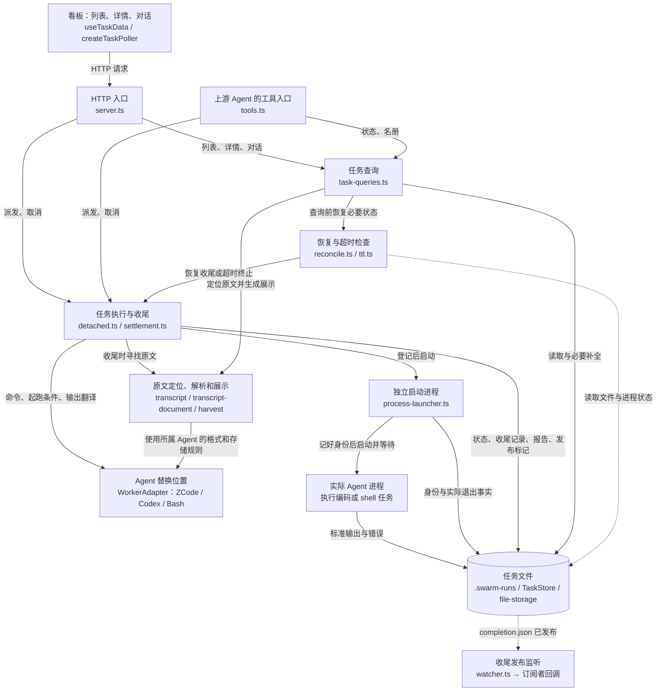
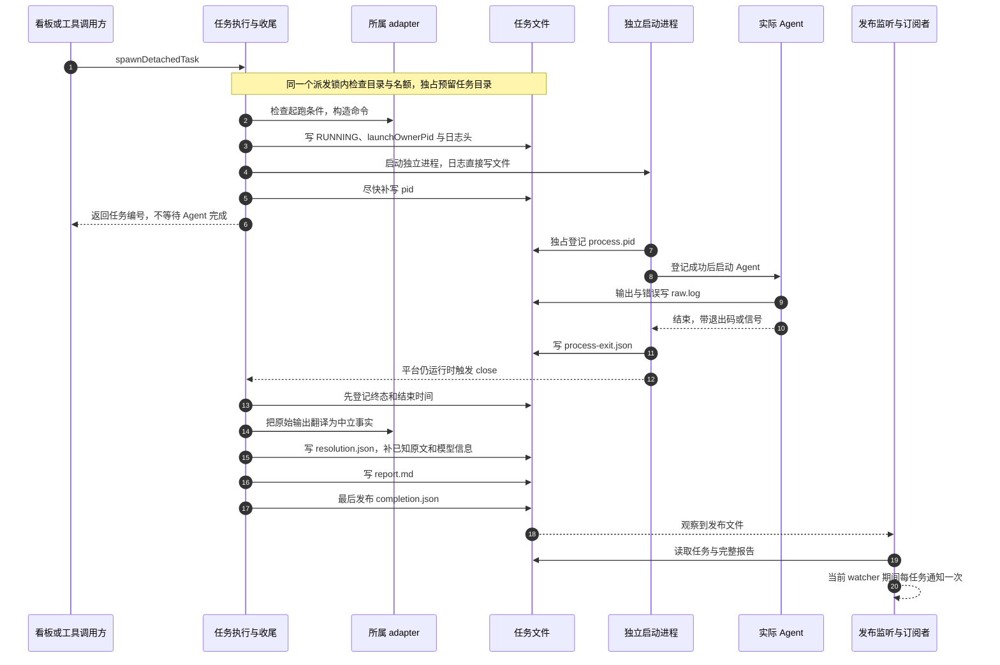
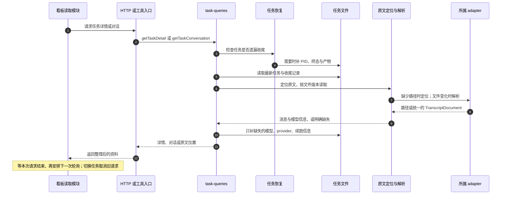
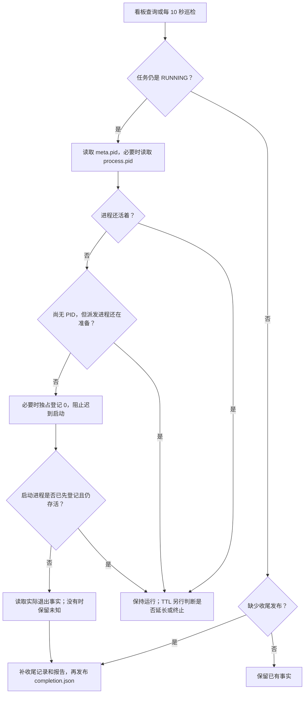

# Agent Hub 全景：模块、seam 与任务时序

核对日期：2026-10-16。依据 `src/` 当前执行路径编写；文档中的图描述已实现行为。旧版概念设计见 [agent-hub 文档](./agent-hub/README.md)，其中尚未实现的能力不属于本图。

Agent Hub 负责把任务交给 Agent、保管机械事实、提供看板和干预入口。**编码工作由独立的 Agent 进程执行；平台不判断代码是否满足需求。** `COMPLETED` 表示进程结束的机械状态，任务内容是否成功仍由人或上游 Agent 判断。

## 1. 先理解三种关系

- **模块**：把一件事情集中做好的一组代码。例如任务查询负责“把这个任务的资料整理给我”。一个模块可以跨多个文件，不能用文件数量判断模块数量。
- **Interface（使用约定）**：调用方需要知道的操作、参数、返回内容、失败情况和顺序。例如 `terminateTask(id, cause)` 会完成终止与收尾，调用方不用再自己写报告。
- **Seam（替换位置）**：可以换掉具体做法的位置。例如换 ZCode 为 Codex，平台仍通过 `WorkerAdapter` 使用它。**每条调用箭头都有使用约定，但不是每条箭头都有必要设计成可插拔的 seam。**

可以把平台看成一个任务办事处：入口接待，任务模块负责派发与收尾，文件存储保管登记簿，adapter 知道如何与不同 Agent 沟通，查询模块把资料整理给看板。

## 2. 模块全景

箭头表示请求、调用或资料传递；虚线表示周期检查、文件观察或外部文件读取。图中把 `TaskStore`、收尾文件读写及底层文件工具合并成“任务文件”，不表示所有读写都经过一个类。

这张图有三个重点：

1. **执行与查询共用登记资料，但分工不同。** 执行模块决定何时启动、停止和收尾；查询模块负责把已知事实整理出来。查询会补齐遗漏的收尾资料，所以它不只是读文件。
2. **Agent 的差异集中在 adapter。** 平台知道“要启动什么命令”和“输出代表哪些事实”，不需要在看板代码里识别 ZCode 或 Codex 格式。
3. **文件是跨进程的交接材料。** 平台进程关闭后，启动进程与 Agent 还能继续运行；重启后的平台通过文件找回身份和退出事实。

图中省略的旁路：实时日志由 HTTP 直接按文件偏移读取并通过 SSE 发送；版本记录由 HTTP 在任务目录调用 jj，必要时回退到 git；在文件管理器中定位原文也是 HTTP 的本机操作。这些尚未归入 `task-queries.ts` 的任务资料拼装流程。

## 3. seam 在哪里，替换后谁不必跟着改

| 位置 | 调用方只需要知道什么 | 集中隐藏了什么 | 当前性质 |
| --- | --- | --- | --- |
| `WorkerAdapter` | `buildCommand`，以及可选的检查、翻译、原文定位与解析能力 | CLI 参数、启动配置、各 Agent 的输出和原文格式 | 真实 seam：已有 ZCode、Codex、Bash 三种 adapter |
| `TranscriptDocument` | 消息列表与模型信息 | 原始 JSON / JSONL 的格式差异 | adapter 到展示代码之间的数据交接约定 |
| `TaskStore(runsDir)` 与文件工具 | 创建、读取、合并更新、列举和读取日志尾部 | 目录、编号校验、并发更新、原子替换 | 具体文件实现；目录可换，尚无第二种数据库 adapter |
| `spawnDetachedTask / terminateTask / completeTask` | 派发、取消或提供结束事实 | 进程组、首次终态保留、收尾与报告顺序 | 任务模块的使用入口；不是额外的通用执行插件框架 |
| `getTaskDetail / getTaskConversation / listTasks` | 任务编号和查询选项 | 恢复、补字段、找原文、拼资料 | 查询模块的使用入口；HTTP 与工具共用 |
| `SwarmRunsWatcher.subscribe`、`onCompletion` | 接收任务与报告的回调 | 文件监听和当前运行期间的去重 | 可替换通知接收方；不承担持久化投递 |
| `startServer → close` | 启动并获得关闭能力 | HTTP、Vite、watcher、watchdog 的资源释放 | 整个平台运行资源的统一拥有者 |

**深度来自“调用方少操心”。** 例如取消任务只调用一次 `terminateTask`，不需要先杀进程、再改状态、再翻译输出、再写报告。内部仍可以分成几个小文件，但调用方不需要了解这些步骤。

`TranscriptRef` 与 `SessionRef` 回答两个不同问题：前者是“原文在哪里”，后者是“下次如何继续”。即便某个 Agent 恰好给出同一个值，平台也不应把两者混为一谈。

## 4. 一次任务：从派发到可通知

上图是正常路径；父进程补写 `meta.pid` 与启动进程登记 `process.pid` 的先后可能交错。真正必须成立的顺序只有：

- **先占名额，再启动进程。** 写任务登记失败时，不能先把 Agent 放出去。
- **启动进程先登记身份，再启动 Agent。** 父进程意外退出后，仍有办法找到活进程。
- **先记录停止事实，再补收尾产物，最后发布通知标记。** 中途出错可恢复；收到通知的人不必猜报告是否写完。

起跑条件不满足时，平台记录 `FAILED` 和未满足条件，完成收尾；不会启动 Agent。平台关闭时，上图的 `close` 回调可能缺席，后面的收尾由恢复路径补做。

## 5. 看板读取资料：先整理，再展示

详情中的最后回复与对话页都从同一份消息列表产生。没有可读原文时，详情仍可使用收尾记录的 `finalText`；对话页明确说明缺少原文，不把一段最终回复伪造成完整对话。

原文缓存按所属 Agent、路径、文件身份、大小及修改时间区分；文件改变后重新读取。最多缓存 32 个文件，单个文件超过 8MiB 时不保留缓存。详情日志读取最多末尾 20KB，再返回最后 5000 字符，避免每次刷新搬运整份日志。

ZCode、Codex 都有格式解析，但当前只有 ZCode 提供本地原文定位。**能解析一种格式不等于已经能自动找到这种 Agent 的原文。** Bash 没有结构化原文能力时，平台保留其输出作为最终文字。

## 6. 平台关闭、取消和异常恢复

- **平台正常关闭**：停止 watchdog、取消订阅、关闭 watcher、Vite 与 HTTP，断开 SSE。已经独立启动的任务继续运行。
- **用户取消或 TTL 终止**：通过同一个 `terminateTask` 入口处理。POSIX 优先结束整个进程组，Windows 使用进程树终止；首次记录的终态保留，晚到退出事实仍可补充。
- **父进程在保存 PID 前退出**：启动进程已登记身份时，从 `process.pid` 补回；尚未登记时，恢复与启动通过独占创建竞争登记位置。恢复先记下 `0`，迟到的启动就不会执行 Agent。
- **进程已结束，但收尾缺席**：有 `process-exit.json` 时用实际退出事实；没有时只知道“进程不在”，不能编造退出码或内容成功的判断。

`RUNNING` 包含“名额已占、正在准备启动”的短暂阶段，不保证此刻已经有 Agent 工作。运行状态只有 `RUNNING / COMPLETED / FAILED / KILLED / TIMEOUT_KILLED`；图中的准备、登记、发布步骤没有新增任务状态。

## 7. 文件之间如何交接

| 文件 | 谁写 | 回答什么问题 |
| --- | --- | --- |
| `meta.json` | 文件存储，由任务执行、恢复或查询更新 | 任务是谁、在哪里、当前机械状态、已知 PID 和时间 |
| `process.pid` | 启动进程；必要时由恢复或取消独占写 `0` | 谁持有启动身份，是否已经阻止迟到启动 |
| `raw.log` | 平台写日志头，Agent 直接写输出与错误，watchdog 可补操作说明 | 进程输出了什么 |
| `process-exit.json` | 独立启动进程 | Agent 实际怎样退出，包括启动错误 |
| `resolution.json` | 收尾逻辑；原文定位可补已知引用 | 为何停止、最终文字、续跑与原文引用、观察事实 |
| `report.md` | 收尾逻辑 | 供人阅读的任务摘要 |
| `completion.json` | 收尾逻辑在报告准备好后发布 | 已有可供通知读取的产物 |

这些文件不构成一次同时提交的事务。可靠性依靠明确顺序、单文件原子替换、跨进程互斥，以及中断后的恢复。`completion.json` 也不是任务内容成功的证明。

通知的去重限于当前 watcher 生命周期；启动前已有的终态任务作为历史基线。它不是保证重启补发的消息队列。平台提供 `onCompletion` 回调；当前 DSH 入口的 `currentAgent` 尚无赋值入口，因此不能把“自动回注到活跃 Agent”描述成已接通的保证。

## 8. 按职责找到代码

| 想看什么 | 代码 |
| --- | --- |
| 看板如何刷新与隔离过期请求 | [task-data.ts](../src/web/lib/task-data.ts)、[use-task-data.ts](../src/web/hooks/use-task-data.ts) |
| 平台运行资源如何启动与关闭 | [server.ts](../src/server.ts)、[cli.ts](../src/cli.ts)、[index.ts](../src/index.ts) |
| 工具如何转给执行与查询 | [tools.ts](../src/tools.ts) |
| 任务如何派发、终止和收尾 | [detached.ts](../src/runner/detached.ts)、[settlement.ts](../src/runner/settlement.ts) |
| 任务资料如何整理 | [task-queries.ts](../src/runner/task-queries.ts) |
| Agent 差异如何替换 | [base.ts](../src/adapters/base.ts)、[registry.ts](../src/adapters/registry.ts) |
| 如何保证先记身份再启动 | [process-launcher.ts](../src/runner/process-launcher.ts) |
| 如何保管文件、处理并发 | [task-store.ts](../src/runner/task-store.ts)、[file-storage.ts](../src/runner/file-storage.ts) |
| 如何定位和解读原文 | [transcript.ts](../src/runner/transcript.ts)、[transcript-document.ts](../src/runner/transcript-document.ts)、[transcript-format.ts](../src/adapters/transcript-format.ts) |
| 如何由事实生成展示 | [harvest.ts](../src/runner/harvest.ts)、[shared/transcript.ts](../src/shared/transcript.ts) |
| 如何恢复和处理超时 | [reconcile.ts](../src/runner/reconcile.ts)、[ttl.ts](../src/runner/ttl.ts)、[timeout-policy.ts](../src/runner/timeout-policy.ts) |
| 如何在发布后通知 | [watcher.ts](../src/watcher.ts) |
| 人工命令读取 Agent 原文的另一条路径 | [read-transcript.ts](../src/runner/read-transcript.ts)、[readback.ts](../src/runner/readback.ts)；当前是 ZCode 专用，保留实际用途 |

## 9. 本次清理

删除已无产品调用的旧包装：`transcript-compat.ts`、`summarizeTranscript`、`extractLastAssistantMessage`、`harvestTask`、`filterBoardTasks`、`formatModelLabel` 和未使用的 `DiffData` 类型别名。测试改为验证当前解析、投影、归档查询入口，原有场景保留。移除无用引用，并修正 adapter 注释与实际职责不一致的问题。

人工原文读取命令、历史元数据恢复和对外的 `/diff` 重定向仍有兼容用途。广义 `AdapterContractV1`、完整能力/权限声明、统一事件流和链式派发属于其他设计文档中的规划；本图不宣称它们已经落地。
